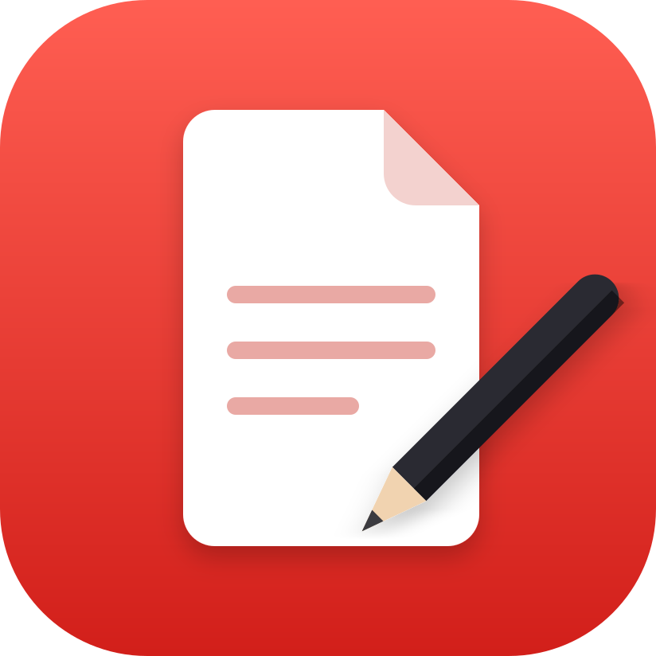

# PdfCraft app icon



**Design:** a white page with a folded corner and three text lines, and a black pencil writing on it,
on a red tile. Minimal and flat with soft gradients and a light shadow, in the manner of macOS app
icons, and legible at 16 px. No lettering.

**Palette:**

| Colour | Hex | Used for |
|---|---|---|
| Red | `#FF5E52` → `#D21F1A` | the tile (top to bottom gradient) |
| Paper | `#FFFFFF`, fold `#F3D2CF` | the page |
| Text lines | `#E9A9A4` | the page's three lines |
| Graphite | `#2A2A30` | the pencil |

**Tile:** the viewBox is the tile (`100 100 824 824`, corner radius 185), full bleed. Windows and Linux
icons use it as is. macOS icons put it on Apple's grid (an 824 px body centred on a transparent
1024 px canvas).

**Provenance:** original artwork for the Women for Women International build, written by hand as SVG
(no tracing, fonts or third-party material). It replaces the upstream lion icon. Licence:
[LICENSE.txt](LICENSE.txt) (`MIT OR Apache-2.0`, like the repo).

## Files

| File | What it is |
|---|---|
| `pdfcraft.svg` | the master vector; every PNG, `.ico` and `.icns` is rendered from it |
| `pdfcraft-small.svg` | a copy of the master, kept for the About dialog and this README |
| `pdfcraft-1024.png` | 1024 px on Apple's grid; also the runtime Dock icon on macOS |
| `pdfcraft.icns` | macOS icon (16–1024 px) |
| `pdfcraft.ico` | Windows icon (16–256 px), embedded in `pdfcraft.exe` by `apps/pdfcraft/build.rs` |
| `pdfcraft-document.svg` | Windows PDF file icon master: a Lucide document outline, red badge and outlined PDF lettering; no font dependency |
| `pdfcraft-document.ico` | Windows PDF file icon (16–256 px), embedded as resource 2 in `pdfcraft.exe` |
| `hicolor/<n>x<n>/apps/ai.storyteller.pdfcraft.png` | Linux hicolor theme, 16–512 px; the 256 px one is the runtime icon on Windows and Linux |
| `hicolor/scalable/apps/ai.storyteller.pdfcraft.svg` | Linux scalable icon (copy of the master) |

Where it shows: `apps/pdfcraft/src/main.rs` sets the window icon (Dock, taskbar, Alt-Tab, launcher) and the
Wayland app id `ai.storyteller.pdfcraft`; `packaging/linux/ai.storyteller.pdfcraft.desktop` names the
hicolor icon.

Windows PDF files use resource 2 (`"pdfcraft.exe",-2`) when PdfCraft is chosen as the default
reader; the app keeps resource 1. The document outline is adapted from Lucide `file-text`
1.49.0 (ISC); its badge and outlined lettering are original (`MIT OR Apache-2.0`), covered by
[LICENSE-document.txt](LICENSE-document.txt). Both icons are embedded, requiring no runtime
sidecar. This provides a file type icon; first-page thumbnails still need a thumbnail provider.

## Regenerate

```sh
packaging/icons.sh        # needs resvg and python3; iconutil (macOS) for the .icns
cargo xtask assets        # then update the sha256 values in ATTRIBUTION.toml and run with --write
```
